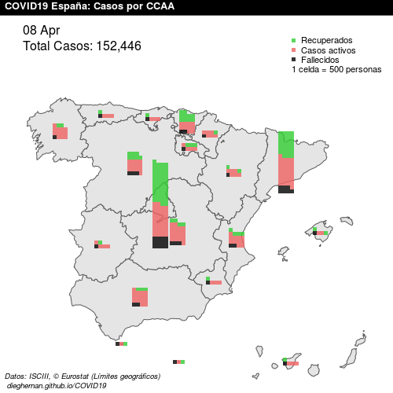
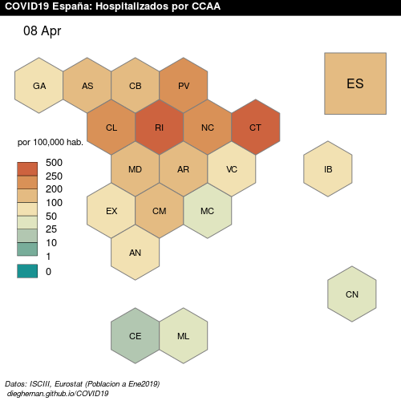
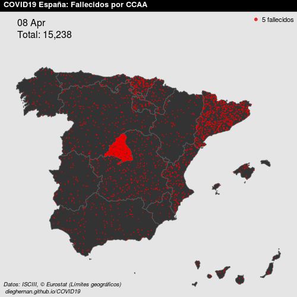

*Datos publicados a 09 abril 2020*

El proyecto
-----------

**Proyecto obsoleto**: Debido a los cambios en el aprovisionamiento de
la información, este proyecto se considera obsoleto y no recibirá más
actualizaciones. 
{: .alert .alert-danger .p-3 .mx-2 mb-3}

Proyecto de código abierto de visualización geográfica de la evolución de la
pandemia COVID-19 en España. Se proporcionan gráficos estáticos en
formato PNG (500 × 500 píxeles) y visualizaciones de evolución en formato
GIF. La página conserva mapas históricos y ya no se actualiza. El archivo de
imágenes PNG diarias se encuentra en [este
repositorio](https://github.com/dieghernan/COVID19/tree/master/assets/png).

-   [Datos históricos](#últimos-datos)
-   [Evolución](#evolución)

[Consultar los datos históricos del repositorio](https://github.com/dieghernan/COVID19/tree/master/assets/data).

**Fuente de datos**

-   Datos oficiales proporcionados por el [Instituto de Salud Carlos III
    (ISCIII)](https://covid19.isciii.es/).
-   © EuroGeographics para los límites administrativos.
-   Datos de población extraídos mediante el paquete
    [`eurostat`](http://ropengov.github.io/eurostat) (© Leo Lahti, Janne
    Huovari, Markus Kainu, Przemyslaw Biecek. Retrieval and analysis of
    Eurostat open data with the eurostat package. [R Journal
    9(1):385-392, 2017.](https://journal.r-project.org/archive/2017/RJ-2017-019/index.html))

**Licencia de uso**

Proyecto generado bajo [**MIT License**](https://github.com/dieghernan/COVID19/blob/master/LICENSE). Se permite la
reutilización siempre y cuando se cite a este repositorio como fuente.

**Buzón de sugerencias**

Este proyecto se plantea como un proyecto colaborativo. Para sugerencias
de nuevas visualizaciones, errores en los datos o cualquier otro asunto
relacionado con este proyecto, puedes ponerte en contacto con los
administradores a través de este enlace:
[Buzón](https://github.com/dieghernan/COVID19/issues/new/choose).

Datos históricos
----------------
{: id="últimos-datos"}

### Casos por situación en España
{: id="total-casos-por-situación-en-españa"}

### Hospitalizaciones por 100.000 habitantes
{: id="hospitalizados-por-100000-habitantes"}

### Contagios en España

### Fallecidos en España

Evolución
---------

Las animaciones muestran datos históricos. Para consultar imágenes fijas,
utiliza la [galería de mapas]({{ '/Galeria' | relative_url }}).

### Evolución de los casos en España
{: id="evolución-casos-en-españa"}

### Evolución de las hospitalizaciones por 100.000 habitantes
{: id="evolución-hospitalizados-por-100000-habitantes"}

### Evolución de los contagios en España
{: id="evolución-contagios-en-españa"}

### Evolución de los fallecimientos en España
{: id="evolución-fallecidos-en-españa"}

------------------------------------------------------------------------

*Generado  con* **RStudio**.
